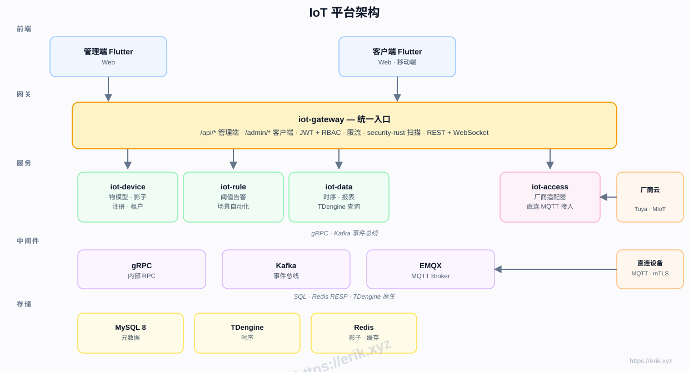
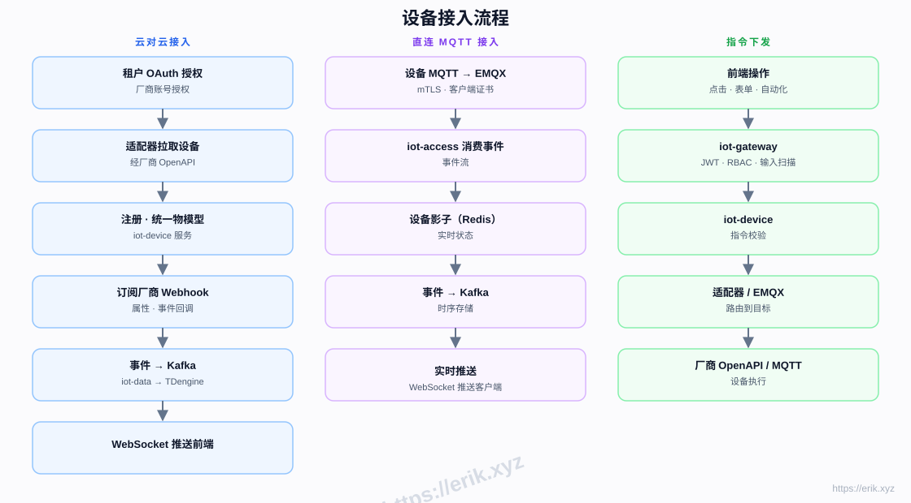
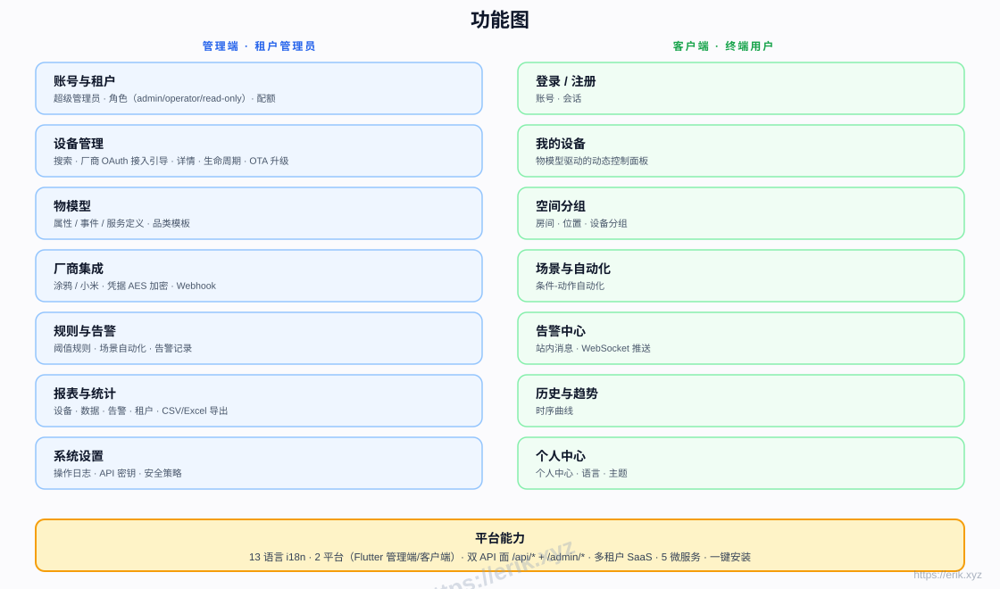
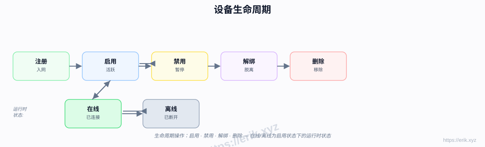
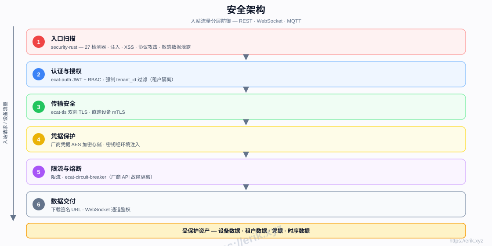
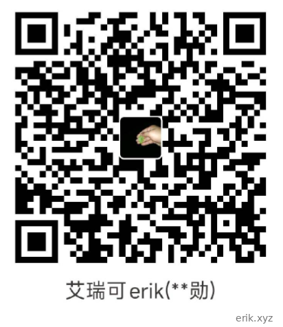

# IoT 物联网管理平台

[中文](README.md) | [English](docs/i18n/README.en.md)

<p align="center">
  
</p>

统一接入主流设备厂商（涂鸦、小米等），提供设备管理、物模型、规则告警、时序数据与多端应用的一站式 SaaS 物联网平台。后端为 Rust 微服务（e-cat 工作区），前端为 Flutter 双端（管理端 / 客户端），支持 13 种语言。

## 功能特性

- **多厂商接入**：云对云 OAuth 接入（涂鸦 / 小米）+ 直连 MQTT（mTLS）
- **物模型**：属性 / 事件 / 服务统一建模，管理端建模、客户端动态渲染
- **设备生命周期**：注册 → 启用 / 禁用 → 解绑 → 删除，运行时在线 / 离线状态
- **规则与告警**：阈值规则、场景自动化、WebSocket 实时推送
- **数据与报表**：TDengine 时序存储、历史曲线、CSV/Excel 导出
- **多租户 SaaS**：租户隔离、配额、角色权限（admin / operator / read-only）
- **安全**：security-rust 入站扫描、JWT + RBAC、双向 TLS、凭据 AES 加密、限流与熔断
- **13 语言 i18n**，Flutter Web / Mobile 管理端与客户端双端

## 架构图



## 设备接入流程图



## 功能图



## 生命周期图



## 安全架构



## 技术栈

| 层 | 技术 |
|----|------|
| 前端 | Flutter（Web / Mobile） |
| 后端 | Rust（axum · tokio · gRPC）· security-rust 安全扫描 |
| 中间件 | EMQX（MQTT）· Kafka（事件总线）· gRPC（内部 RPC） |
| 存储 | MySQL 8（元数据）· TDengine（时序）· Redis（影子 / 缓存） |
| 接入 | 云对云 OAuth 适配器 · 直连 MQTT（mTLS） |

## 目录结构

```
├── apps/            # 前端应用
│   ├── admin/       # 管理端（Flutter）
│   └── client/      # 客户端（Flutter）
├── e-cat/           # Rust 工作区（框架 + 业务微服务一体）
│   └── ecat*/       # 框架公共库 + 业务微服务（ecat · ecat-auth · ecat-gateway · ecat-device · ecat-access · ecat-rule · ecat-data-service · ecat-data-* …）
├── docs/            # 文档、架构图、打赏图片
├── scripts/         # 构建 / 校验 / 冒烟测试脚本
└── docker-compose.yml  # 基础设施编排（MySQL / Redis / EMQX / Kafka / TDengine）
```

## 一键安装

```bash
git clone https://github.com/erikwang2013/iot-platform.git
cd iot-platform
./scripts/install.sh
```

脚本将自动完成：拉起基础设施（MySQL / Redis / EMQX / Kafka / TDengine）→ 构建 5 个业务服务 → 生成 .env 配置 → 打印服务清单与启动命令。重复运行安全。

## 安装说明

### 前置依赖

- Docker 24+ 与 docker compose（或 docker-compose）
- Rust 1.80+（stable，用于编译业务服务；已安装 cargo 时脚本自动构建）
- 端口占用检查：8080-8084、3306、6379、1883、9092、6041 需空闲

### 安装步骤

1. 安装并启动基础设施：`./scripts/install.sh` 会执行 `docker compose up -d`
2. 构建业务服务：脚本检测到 cargo 后自动 `cargo build --release`，二进制输出至 `scripts/bin/`（或直接使用 `e-cat/target/release/` 下的产物）
3. 启动服务：按脚本末尾打印的命令逐个启动 5 个业务服务
4. 数据库迁移：服务启动时自动执行，无需手动操作；首次启动 iot-access 会自动创建默认租户与管理员账号

## 使用说明

### 登录

- 管理端：使用默认账号 `admin / admin123`（租户 `tenant-1`）登录

### 服务端口

| 服务 | 端口 |
|------|------|
| iot-gateway（网关 / 开放 API） | 8080 |
| iot-device（设备服务） | 8081 |
| iot-access（接入 / 认证） | 8082 |
| iot-data（数据服务） | 8083 |
| iot-rule（规则引擎） | 8084 |
| MySQL / Redis / EMQX / Kafka / TDengine | 3306 / 6379 / 1883 / 9092 / 6041 |

### 模块使用

- **设备管理**：管理端添加设备 → 选择厂商 OAuth 接入或直连 MQTT，设备详情查看在线状态与生命周期
- **物模型**：为设备品类定义属性 / 事件 / 服务，客户端控制面板自动渲染
- **规则与告警**：配置阈值规则与场景自动化，触发后 WebSocket 实时推送
- **历史数据**：iot-data 存储时序数据，查看历史曲线并导出 CSV / Excel
- **报表统计**：设备 / 数据 / 告警 / 租户多维报表
- **多厂商接入**：涂鸦 / 小米 云对云 OAuth 适配

## 实施阶段

| 阶段 | 内容 |
|------|------|
| P0 骨架 | 仓库结构、iot-gateway + iot-device + Docker 编排（MySQL/Redis/EMQX/Kafka） |
| P1 接入 | iot-access + 涂鸦适配器 + 直连 MQTT |
| P2 数据 | iot-data + TDengine + 历史曲线 |
| P3 规则 | iot-rule 告警 + 场景自动化 |
| P4 多厂商 | 小米适配器 |
| P5 前端 | apps/admin + apps/client 全端 |
| P6 上线 | 安全加固、压测、OTA |

## 支持与打赏

您的支持是项目持续发展的动力，欢迎打赏，万分感谢！

### 扫码打赏（微信 / 支付宝）

<p>
  
  
</p>

微信支付（WeChat Pay） · 支付宝（Alipay）

## 项目授权 / Project License

Copyright (c) 2026 erik <erik@erik.xyz> — https://erik.xyz

- 本项目仅供个人学习、研究使用。
- 未经作者书面授权，禁止任何形式的商业使用（包括但不限于商业部署、付费服务、二次销售、SaaS 运营及以本项目为基础提供商业服务）。
- 商业授权请联系 **erik@erik.xyz**。
- 未经授权的商业使用，作者将在全球范围内依法追究法律责任，并保留终身追责的权利。
- 第三方组件仍遵循其各自原有的许可证；视觉资产适用仓库内的 ASSETS-LICENSE.md（如适用）。

**English:** This project is provided for personal study and research only. Commercial use of any kind requires prior written authorization from the author (erik@erik.xyz). Unauthorized commercial use will be pursued for legal liability worldwide, and the author reserves the right to pursue such liability for life. Third-party components remain under their original licenses; visual assets are governed by ASSETS-LICENSE.md where applicable.

## 项目宠物表情形态 · IoT Bot

<table align="center">
<tr><td align="center"><br><b>笑</b><br><code>:emoji-smile:</code></td><td align="center"><br><b>欢乐</b><br><code>:emoji-joy:</code></td><td align="center"><br><b>哭</b><br><code>:emoji-cry:</code></td><td align="center"><br><b>沮丧</b><br><code>:emoji-depressed:</code></td><td align="center"><br><b>惊恐</b><br><code>:emoji-terrified:</code></td><td align="center"><br><b>愤怒</b><br><code>:emoji-angry:</code></td></tr>
<tr><td align="center"><br><b>撒娇</b><br><code>:emoji-coquettish:</code></td><td align="center"><br><b>卖萌</b><br><code>:emoji-cute:</code></td><td align="center"><br><b>讨好</b><br><code>:emoji-pleasing:</code></td><td align="center"><br><b>敲打</b><br><code>:emoji-knocking:</code></td><td align="center"><br><b>捂脸</b><br><code>:emoji-facepalm:</code></td><td align="center"><br><b>吐舌头</b><br><code>:emoji-tongue:</code></td></tr>
</table>

> 12 种彩色动态形态：笑 / 欢乐 / 哭 / 沮丧 / 惊恐 / 愤怒 / 撒娇 / 卖萌 / 讨好 / 敲打 / 捂脸 / 吐舌头。每个 SVG 自带表情、情绪特效与整体动效，并遵循 `prefers-reduced-motion`。
<!-- pet-expressions:end -->

<!-- assets-license:start -->
## 视觉资产授权 / Visual Assets License

本项目的项目宠物、图片、图标、表情（包括 `docs/pet-expressions/` 等目录下的
SVG / PNG）**不是开源资产**，版权归作者所有。未经书面许可不得复制、修改、再分发或
用于商业用途；商业使用需取得商业授权，联系 **erik@erik.xyz**。详见
[ASSETS-LICENSE.md](ASSETS-LICENSE.md)。

> 代码部分仍遵循仓库原有 `LICENSE`；第三方素材（如明确标注的 Go Gopher 等）仍遵循其原许可证。
<!-- assets-license:end -->
