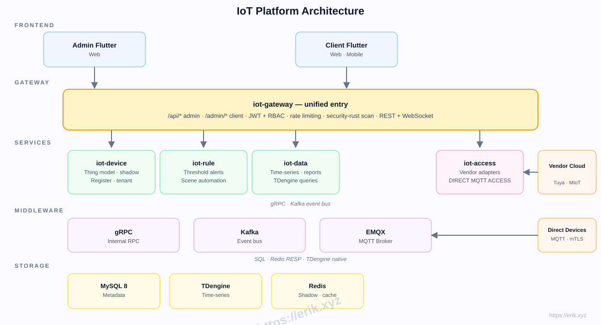
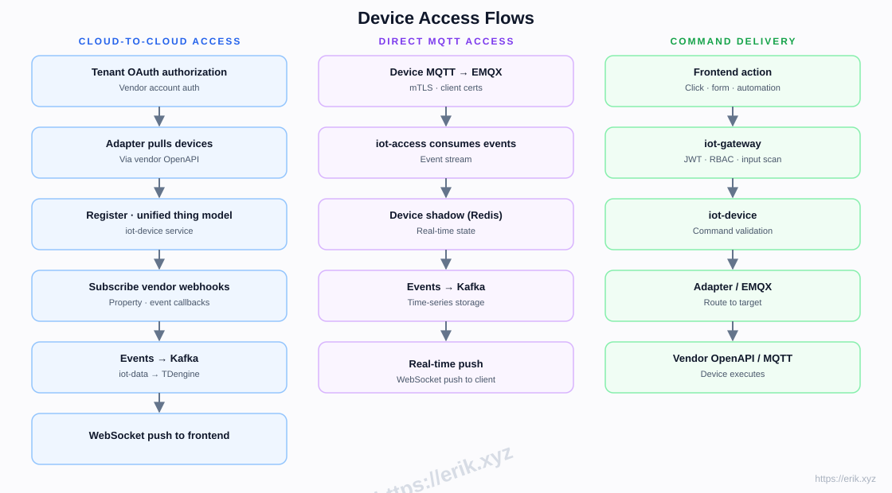
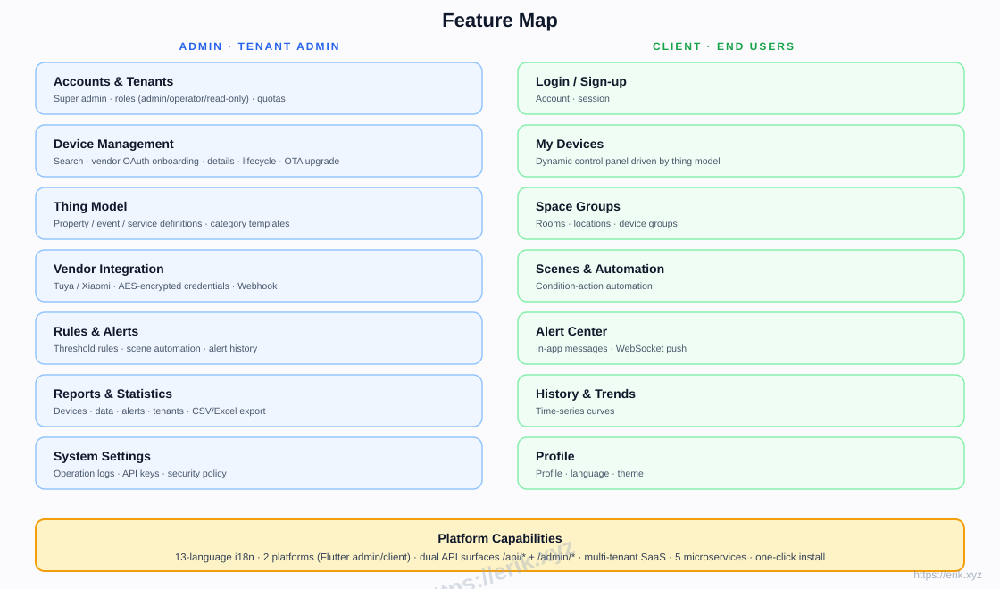
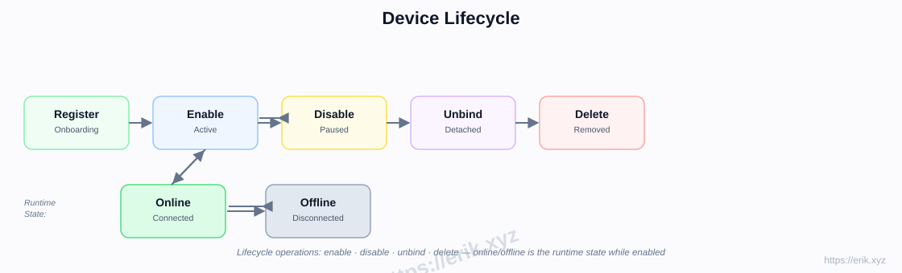
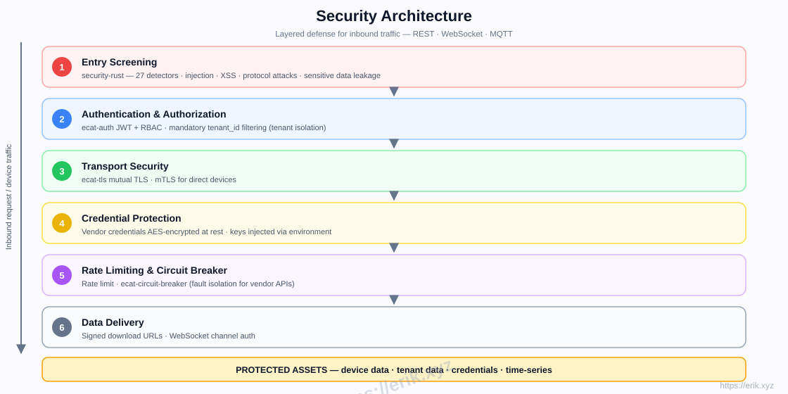

# IoT Platform

[中文](../../README.md) | [English](README.en.md)


A one-stop SaaS IoT platform that unifies access to major device vendors (Tuya, Xiaomi, etc.), providing device management, thing models, rules & alerts, time-series data, and multi-platform apps. The backend is a Rust microservice workspace (e-cat); the frontends are Flutter, with support for 13 languages.

## Features

- **Multi-vendor access**: cloud-to-cloud OAuth (Tuya / Xiaomi) + direct MQTT (mTLS)
- **Thing model**: unified modeling of property / event / service — modeled in admin, rendered dynamically in client
- **Device lifecycle**: register → enable / disable → unbind → delete, with online / offline runtime status
- **Rules & alerts**: threshold rules, scene automation, real-time WebSocket push
- **Data & reports**: TDengine time-series storage, history curves, CSV/Excel export
- **Multi-tenant SaaS**: tenant isolation, quotas, roles (admin / operator / read-only)
- **Security**: security-rust inbound scanning, JWT + RBAC, mutual TLS, AES-encrypted credentials, rate limiting & circuit breaker
- **13-language i18n**, across the Flutter admin and client apps

## Architecture



## Device Access Flows



## Feature Map



## Device Lifecycle



## Security Architecture



## Tech Stack

| Layer | Technology |
|----|------|
| Frontend | Flutter (Web / Mobile) |
| Backend | Rust (axum · tokio · gRPC) · security-rust scanning |
| Middleware | EMQX (MQTT) · Kafka (event bus) · gRPC (internal RPC) |
| Storage | MySQL 8 (metadata) · TDengine (time-series) · Redis (shadow / cache) |
| Access | Cloud-to-cloud OAuth adapters · direct MQTT (mTLS) |

## Repository Layout

```
├── apps/            # Frontend apps
│   ├── admin/       # Admin console (Flutter)
│   └── client/      # Client app (Flutter)
├── e-cat/           # Rust 工作区（框架 + 业务微服务一体）
│   └── ecat*/       # 框架公共库 + 业务微服务（ecat · ecat-auth · ecat-gateway · ecat-device · ecat-access · ecat-rule · ecat-data-service · ecat-data-* …）
├── ../            # Docs, diagrams, donation images
├── scripts/         # Build / validation / smoke-test scripts
└── docker-compose.yml  # Infrastructure (MySQL / Redis / EMQX / Kafka / TDengine)
```

## One-Click Install

```bash
git clone https://github.com/erikwang2013/iot-platform.git
cd iot-platform
./scripts/install.sh
```

The script automatically: starts the infrastructure (MySQL / Redis / EMQX / Kafka / TDengine) → builds the 5 business services → generates the .env config → prints the service list and start commands. Safe to run repeatedly.

## Installation Guide

### Prerequisites

- Docker 24+ and docker compose (or docker-compose)
- Rust 1.80+ (stable, for building the services; the script builds automatically if cargo is installed)
- Port availability: 8080-8085, 3306, 6379, 1883, 9092, 9000-9001, 6041 must be free

### Installation Steps

1. Start the infrastructure: `./scripts/install.sh` runs `docker compose up -d`
2. Build services: the script runs `cargo build --release` when cargo is detected, outputting binaries to `scripts/bin/` (or use the ones under `e-cat/target/release/`)
3. Start services: launch the 5 services one by one with the commands printed at the end of the script
4. Database migration: runs automatically on service start; on first boot iot-access creates the default tenant and admin account

## Usage

### Login

- Admin console: log in with the default account `admin / admin123` (tenant `tenant-1`)

### Service Ports

| Service | Port |
|------|------|
| iot-gateway (gateway / public API) | 8080 |
| iot-device (device service) | 8081 |
| iot-access (ingress / auth) | 8082 |
| iot-data (data service) | 8083 |
| iot-rule (rule engine) | 8084 |
| MySQL / Redis / EMQX / Kafka / TDengine | 3306 / 6379 / 1883 / 9092 / 6041 |

### Module Usage

- **Device management**: add devices in the admin console → choose vendor OAuth or direct MQTT; check online status and lifecycle in device details
- **Thing model**: define property / event / service for device categories; the client dashboard renders automatically
- **Rules & alerts**: configure threshold rules and scene automation; real-time WebSocket push on trigger
- **History data**: iot-data stores time-series data; view history curves and export CSV / Excel
- **Reports & statistics**: multi-dimensional reports on devices / data / alerts / tenants
- **Multi-vendor access**: cloud-to-cloud OAuth adapters for Tuya / Xiaomi

## Implementation Phases

| Phase | Scope |
|------|------|
| P0 Skeleton | Repo structure, iot-gateway + iot-device + Docker orchestration (MySQL/Redis/EMQX/Kafka) |
| P1 Access | iot-access + Tuya adapter + direct MQTT |
| P2 Data | iot-data + TDengine + history curves |
| P3 Rules | iot-rule alerts + scene automation |
| P4 Multi-vendor | Xiaomi adapter |
| P5 Frontend | apps/admin + apps/client full-stack |
| P6 Launch | Security hardening, load testing, OTA |

## Support & Donations

Your support keeps this project going. Donations are greatly appreciated!

### Scan to Donate (WeChat Pay / Alipay)


WeChat Pay · Alipay

## License

This project's code is provided for learning and communication purposes only.


## 项目授权 / Project License

Copyright (c) 2026 erik erik@erik.xyz — https://erik.xyz

- 本项目仅供个人学习、研究使用。
- 未经作者书面授权，禁止任何形式的商业使用（包括但不限于商业部署、付费服务、二次销售、SaaS 运营及以本项目为基础提供商业服务）。
- 商业授权请联系 **erik@erik.xyz**。
- 未经授权的商业使用，作者将在全球范围内依法追究法律责任，并保留终身追责的权利。
- 第三方组件仍遵循其各自原有的许可证；视觉资产适用仓库内的 ASSETS-LICENSE.md（如适用）。

**English:** This project is provided for personal study and research only. Commercial use of any kind requires prior written authorization from the author (erik@erik.xyz). Unauthorized commercial use will be pursued for legal liability worldwide, and the author reserves the right to pursue such liability for life. Third-party components remain under their original licenses; visual assets are governed by ASSETS-LICENSE.md where applicable.
